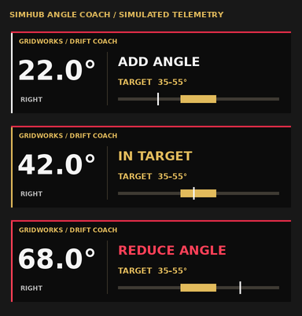

# Gridworks Drift Coach

**Beta Version 2.0 · build 7.10.0**

Local Assetto Corsa drift coaching, car/setup tools, individual run review, native SimHub dashboards and a compact Angle Coach overlay.

## Download

Open [Releases](https://github.com/lmonroe8/gridworks-drift-coach-releases/releases) and choose the latest Gridworks beta:

| File | Use |
| --- | --- |
| **Gridworks-Drift-Coach-Beta-2.0.zip** | New installation: extract and run **Gridworks-Setup.exe**. The ZIP contains the installer and Start Here guide. |
| **Gridworks-Small-Update-7.10.0.zip** | Existing builds **7.9.7, 7.9.8 or 7.9.9**: extract and run **Update-Gridworks.cmd** after finishing your session. Reuses the installed runtime. |

Use the named release assets. GitHub's automatically generated **Source code** archives contain the release-channel repository, not the Gridworks app.

## What you need

- A Windows gaming PC with original **Assetto Corsa**, **Content Manager**, **Custom Shaders Patch (CSP)** and **SimHub**.
- Stream Deck XL, OBS, a tablet and a second display are optional.
- The installer contains the app, its private Python runtime, both dashboards, the Angle Coach overlay, supported game links, Stream Deck profile and icon pack. Python is not a separate end-user prerequisite.

Follow the included **START-HERE.html**. After installing, use the **Gridworks Drift Coach Beta 2.0** shortcut. The controller/browser app runs locally on your PC.

## What's included

- **Angle Coach:** 360 × 108 native click-through overlay showing live absolute drift angle, saved car target and **ADD ANGLE / IN TARGET / REDUCE ANGLE**. Use AC windowed/borderless mode for SimHub overlays.
- **Setup Lab:** six starting guides, baseline/revision tools and setup import/export. Guides are tuning starting points, not proven competition-driver setups.
- **Run replay:** individual recordings grouped by car, track and layout, synchronized driven path, speed, angle and pedal timeline; playback speed and event jumps. Runs shorter than ten seconds are discarded. Add names, notes, favorites and search.
- **Ready check:** first-launch connection status for the controller, AC, fresh packets, angle, SimHub, CSP, car library and direct setup evidence, with relevant next steps.
- **Keep / Review / Practice:** trace-quality labels, recorded observations and one practice goal. Explanations remain hypotheses; there is no invented competition score.
- **Setup experiments:** compare completed tests only within matching context. Pair by entry speed and tire/road conditions; flag multiple adjustments and unconfirmed setup provenance.
- **Pit / tablet:** opt-in paired display on your home network, automatic driving/last-run/setup screens, manual screen lock, quiet coaching and setup checklists.
- **Coach Tools:** a separate optional control-only XL profile, including OBS highlight linking, bookmarks, review, practice and connection tools. Your original 32-key profile and its eight OBS controls are preserved.
- **Data tools:** previewed backup/restore with conflict choices and a safety backup; reviewed diagnostics; balanced/low display settings and hidden-tab pause.
- **Reference Lab:** optional recorded-run comparison with declared provenance. Demo examples are synthetic; no VDC driver reference data is included.
- **Support Message:** prepare a message with optional reviewed app details, then copy/download it for your tester conversation.
- **App updates:** the public signed beta feed is preset in build 7.10.0. Routine app patches download in the background; finish driving and choose **Restart to update**. Saved profiles, setups and recordings stay in place.

App patches update the app, help and bundled exports. For this build, import **Angle Coach 1.2** once for Quiet Coach support. For the new Stream Deck actions, get **Coach Tools** from **Dash settings → Bundled downloads**, extract and run **Install-Coach-Tools.cmd** once. Existing profiles remain in place. Installed SimHub bridge/templates, game links, Stream Deck plugins and runtime changes may require their own installer/import. Older unconfigured builds need the one-time small upgrade above.

## Feedback and support

[Report a bug, suggest a feature or share your tester experience](https://github.com/lmonroe8/gridworks-drift-coach-releases/issues/new/choose). A GitHub account is needed to post an issue; public downloads and update checks do not require one. You can also send the app's prepared Support Message through your existing beta conversation with Leo.

Tell us your build, AC/CSP/SimHub versions, what you expected, what happened and how to repeat it. Do not upload personal files or credentials to public issues.

## Beta status

The automated suite checks app behavior, signed patches, data preservation and startup rollback using temporary fixtures. Linux/Win32 mocks and synthetic previews do not replace live Windows, device and SimHub/AC testing. Please report your rig experience and suggestions.

This repository hosts public releases and the signed update channel. The app source is maintained separately in a private repository. No open-source license is granted for the app by publishing this release channel; third-party components retain their own notices and terms.
